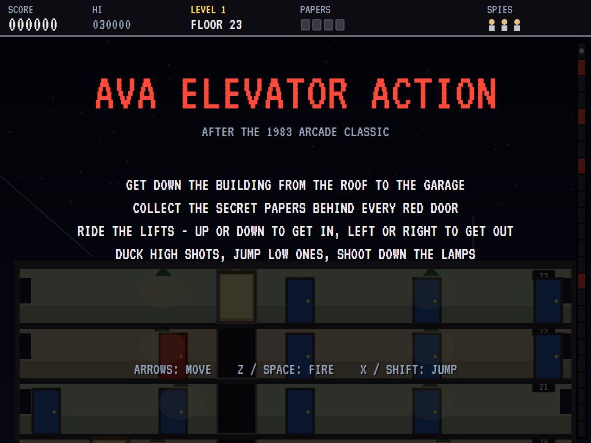
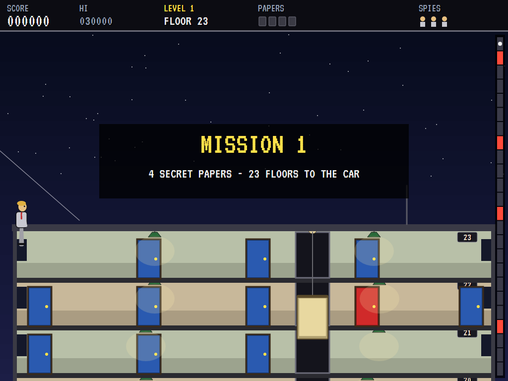
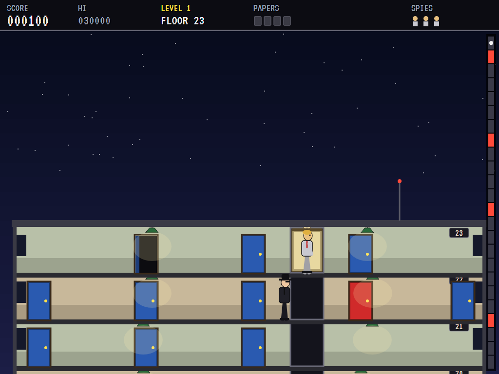
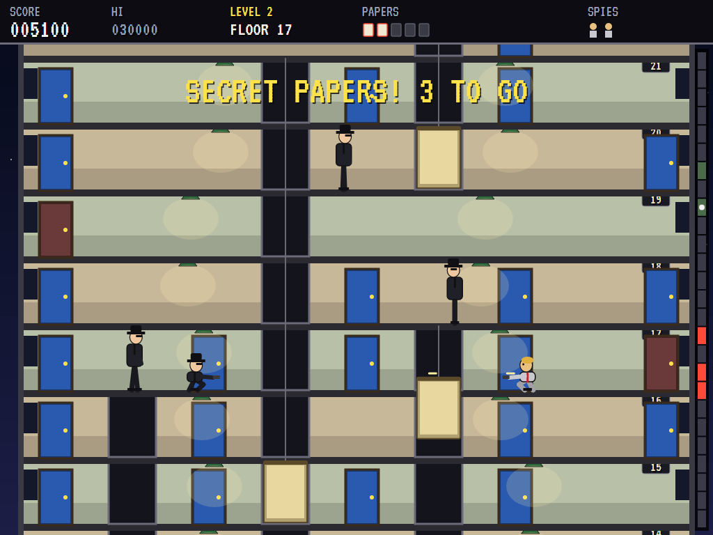
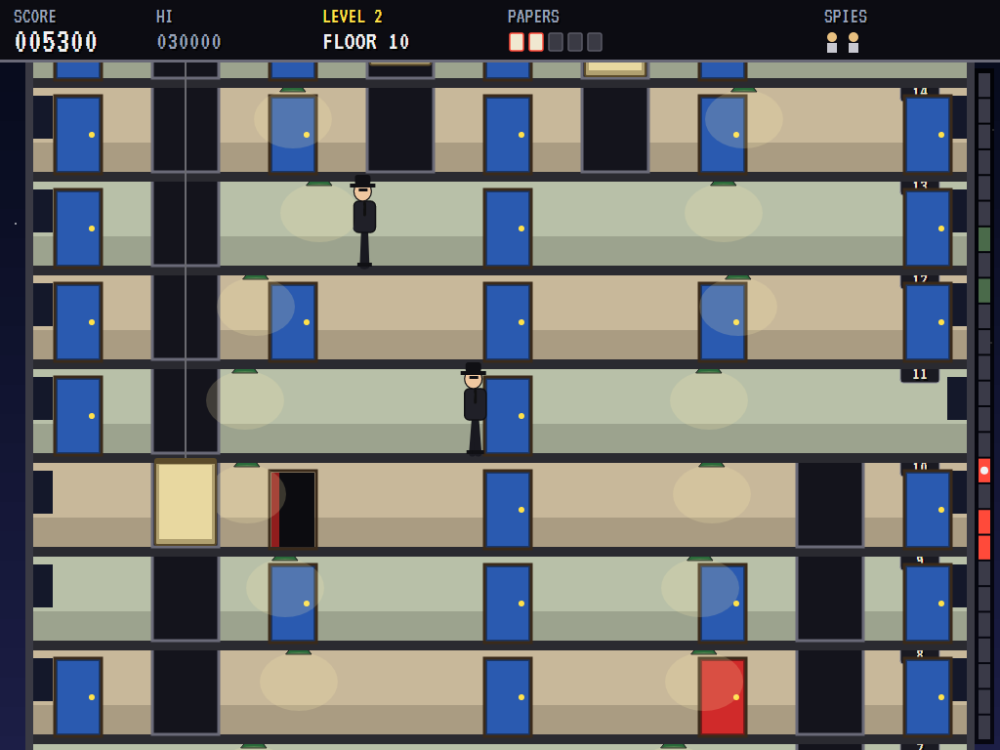
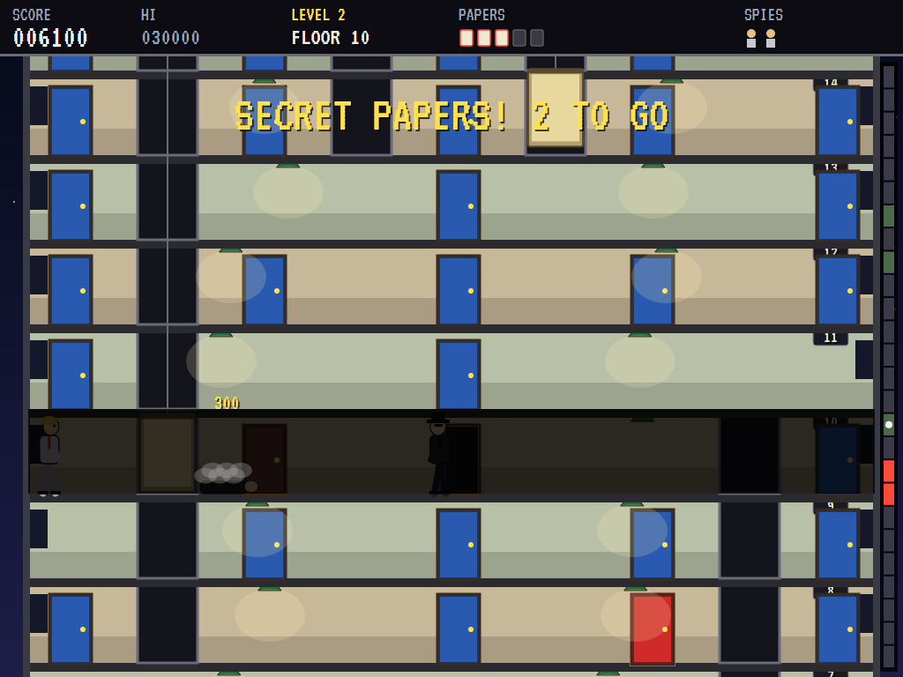
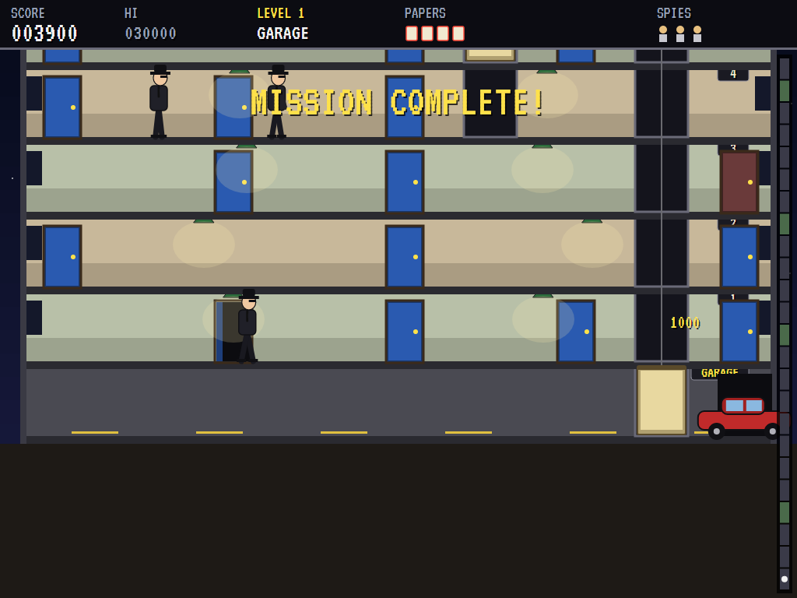
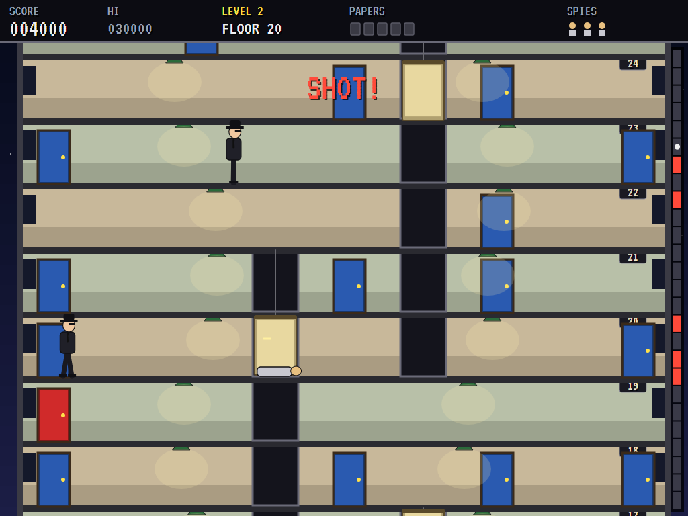
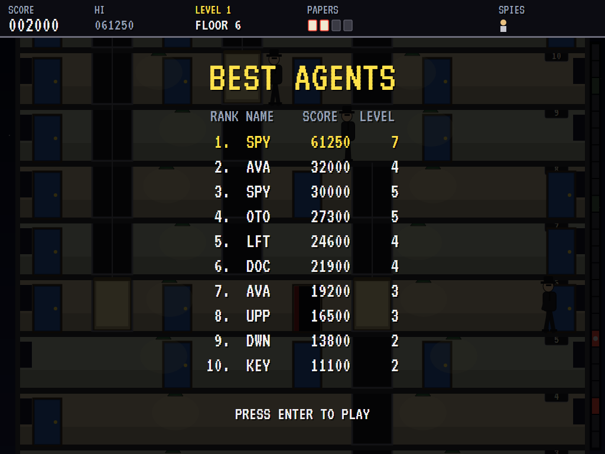

# AVA Elevator Action

[](https://github.com/Harlock123/AVAElevatorAction/actions/workflows/build.yml)

A spy caper in the style of Taito's 1983 arcade game **Elevator Action**, built with .NET 10 and
Avalonia UI. Slide down a line onto the roof of an office tower and work your way down, floor by
floor and lift by lift, to the getaway car in the garage. The secret papers are behind the red
doors, and you need every one of them. Agents in black hats come out of the blue doors shooting.

## Features

- **The building**:
  - **Its size:** a new tower every mission, 24 floors or more (taller each mission), seen in section and scrolling with the spy.
  - **The lifts:** they serve stretches of floors that overlap, so the way down means changing lifts.
  - **Getting about:** up or down at a lift's door gets you in when its car is there, and left or right steps out. An empty car comes to a spy waiting at its door.
  - **The tower map:** a strip down the right edge shows the whole building, the floors where papers are still to be found, and where you are.
- **The papers**: up at a red door goes in for the secret papers. The car in the garage won't leave until you have them all.
- **The agents**:
  - **Where they come from:** they step out of the blue doors on your floor and the floors next to it.
  - **How they fight:** they walk up, take aim, and fire high or low. Duck under the high shots and jump over the low ones.
  - **Dodging:** some see your shots coming and duck or jump them. A shot from a crouch gets a ducking agent.
  - **Kicks:** a jump into an agent knocks him flat.
- **The lamps**:
  - **Shooting one down:** shoot a ceiling lamp at the top of a jump and it comes down.
  - **What it does:** it flattens whoever is beneath it, and the floor goes dark for a while.
  - **Look out:** don't stand under it yourself.
- **The alarm**: take too long and the alarm goes off. The agents come faster and shoot sooner.
- **Three spies**: a new one carries on where the last fell. Extra spies at 20,000 points and every 30,000 after.
- **Sound**: an original sly spy theme over a walking bass, and sounds for the guns, the lift's hum and bell, doors, papers, falling lamps, the alarm, kicks and the car. All mixed by OpenAL.
- **Attract mode**: leave the title alone for 15 seconds and a computer spy goes down the building. It:
  - plans its way through the lifts to each red door and then the car
  - shoots the agents on its floor
  - ducks and jumps their shots
- **A top-ten high-score table** with arcade-style initials entry; it records the mission reached.
- **Gamepads** through SDL2, as well as the keyboard.
- **Any window size**: the screen scales to fit, letterboxed. **Ctrl+S** saves a screenshot.
- **One self-contained executable** per platform: Windows, macOS and Linux on Intel/AMD and ARM.

## Screenshots

| The title | The roof | Going down |
|:---------:|:--------:|:----------:|
|  |  |  |
| The mission. | Down the line onto the roof. | Riding a lift past an agent. |

| A gunfight | Secret papers | Lights out |
|:----------:|:-------------:|:----------:|
|  |  |  |
| Agents high and low, and a jump. | Through a red door. | A lamp shot down onto an agent. |

| The getaway | Shot | The best agents |
|:-----------:|:----:|:---------------:|
|  |  |  |
| All the papers, and into the car. | Caught in a lift. | The high-score table. |

The screenshots are made by the tests, which play the game in a real (headless) window; see
[Tests](#tests).

## Download and run

Ready-to-run builds for Windows, macOS and Linux, on both Intel/AMD and ARM, are on the
[Releases page](https://github.com/Harlock123/AVAElevatorAction/releases/tag/latest). **Latest build** is
rebuilt on every push to `main`. Each download is one self-contained executable: no .NET install is
needed.

| Platform | Archive |
|---|---|
| Windows | `AVAElevatorAction-win-x64.zip`, `AVAElevatorAction-win-x86.zip`, `AVAElevatorAction-win-arm64.zip` |
| macOS | `AVAElevatorAction-osx-arm64.tar.gz` (Apple silicon), `AVAElevatorAction-osx-x64.tar.gz` (Intel) |
| Linux | `AVAElevatorAction-linux-x64.tar.gz`, `AVAElevatorAction-linux-arm64.tar.gz`, `AVAElevatorAction-linux-arm.tar.gz` |

```bash
tar -xzf AVAElevatorAction-linux-x64.tar.gz     # or linux-arm64, linux-arm, osx-arm64, osx-x64
./AVAElevatorAction
```

On Windows, unzip and run `AVAElevatorAction.exe`. On macOS, if Gatekeeper refuses to open it, run
`xattr -d com.apple.quarantine AVAElevatorAction` once. Run with `--no-audio` for silence.

**Sound** comes through OpenAL Soft, built in for every platform. In a virtual machine the game
detects it and uses a larger audio buffer, so the sound doesn't break up.

**Gamepads** use SDL2, which is bundled for Windows, macOS and Intel/AMD Linux. ARM Linux builds need it
installed; without it the keyboard still works:

```bash
sudo apt install libsdl2-dev            # Debian / Ubuntu / Raspberry Pi OS
sudo pacman -S --needed sdl2-compat     # Arch / Omarchy
```

## Controls

| Input | Action |
|-------|--------|
| **Enter** | Start |
| **Left** / **Right** (or **A** / **D**) | Walk; step out of a lift |
| **Down** / **S** | Duck; get into a lift and ride it down |
| **Up** / **W** | Go through a red door; get into a lift and ride it up |
| **Z** / **Space** / **Ctrl** | Fire |
| **X** / **Shift** | Jump |
| **P** / **Esc** | Pause (Esc again to quit) |
| **M** | Mute |
| **Ctrl+S** / **Cmd+S** | Save a screenshot to the Pictures folder |

**Gamepad**: left stick or D-pad to move, **A** to fire, **B** or **Y** to jump, **Start** to start
and pause, **Back** (while paused) to quit.

**Entering initials**: type letters, or dial with **Up**/**Down** and accept with **Space**; **Left** /
**Backspace** go back; **Enter** finishes.

## Scoring

| What | Points |
|---|---:|
| An agent shot | 100 |
| An agent kicked | 150 |
| An agent under a falling lamp | 300 |
| Secret papers | 500 |
| The getaway | 1,000 × the mission |
| Extra spy | at 20,000, then every 30,000 |

## Tests

```bash
dotnet test AVAElevatorAction.slnx
```

The engine has no UI and runs in fixed 60 Hz steps, so it plays the same at any frame rate, and a seed
always plays the same game. The tests check, often in a little building made for the purpose:

- **The building:** every tower can be got down by lift from the roof to the garage, with its papers behind doors on the floors in between.
- **The spy:**
  - walking, ducking and jumping
  - into a lift, down a floor at a time and out
  - an empty lift coming when called
  - a red door's papers, and the car waiting for every one
- **Shooting:**
  - an agent dropped by a shot, but not while ducking unless the shot is low
  - ducking high shots and jumping low ones
  - agents coming out of doors to walk up and shoot
  - a jump kick, and a lamp shot down onto an agent putting the lights out
- **Lives and the machine:**
  - a new spy carrying on where the last fell, and the last one ending it
  - the alarm
  - the computer spy completing a mission
  - the attract mode, initials, the same game from the same seed, and the high-score file

The screenshot tests draw the real screen in a headless window. To refresh the README's pictures:

```bash
ELEVATOR_SHOTS=$PWD/Images dotnet test tests/AVAElevatorAction.Tests --filter ScreenshotTests
```

To see how the computer spy gets on (for tuning):

```bash
SPY_PROBE=1 dotnet test tests/AVAElevatorAction.Tests --filter SpyProbe --logger "console;verbosity=detailed"
```

## Building

```bash
dotnet build AVAElevatorAction.slnx
dotnet run --project src/AVAElevatorAction
```

Needs the .NET 10 SDK. The sounds are made by `tools/make_sounds.py` (standard-library Python):
`python3 tools/make_sounds.py` rewrites `src/AVAElevatorAction/Sounds`.

## Project structure

```
AVAElevatorAction/
├── AVAElevatorAction.slnx
├── src/AVAElevatorAction/
│   ├── Engine/
│   │   ├── GameEngine.cs        # States, the title and demo cycle, and the music
│   │   ├── GameEngine.Play.cs   # The spy, the lifts, agents, bullets, lamps and the dark, the
│   │   │                        # papers, the alarm and the getaway
│   │   ├── Building.cs          # Each mission's tower: floors, lift shafts, doors and lamps
│   │   ├── SpyPilot.cs          # The computer spy, for the demonstration (and the tests)
│   │   ├── Entities.cs
│   │   ├── HighScoreTable.cs, InitialsEntry.cs
│   │   ├── InputHandler.cs, ControllerManager.cs  # Keys and an SDL2 gamepad
│   │   └── SoundManager.cs      # Effects, the mission music and the tunes through OpenAL
│   ├── Audio/                   # The OpenAL engine (from the author's AVABand)
│   ├── Views/                   # The building in section, the lifts, the people and the screens
│   └── Sounds/                  # The synthesised effects and tunes
├── tests/AVAElevatorAction.Tests/  # Gameplay, screenshot and probe tests
├── tools/make_sounds.py
└── Images/                      # Screenshots
```

## About and licence

AVA Elevator Action © 2026 Lonnie Watson, under the [MIT License](LICENSE).

*Elevator Action* © 1983 Taito; the name belongs to its current owner. AVA Elevator Action is an
independent, unofficial game in its style. Its buildings, characters, graphics, sounds, tunes and code
are its own; nothing is taken from the arcade machine's program, graphics, sound or music. It is not
affiliated with or endorsed by any rights holder.
